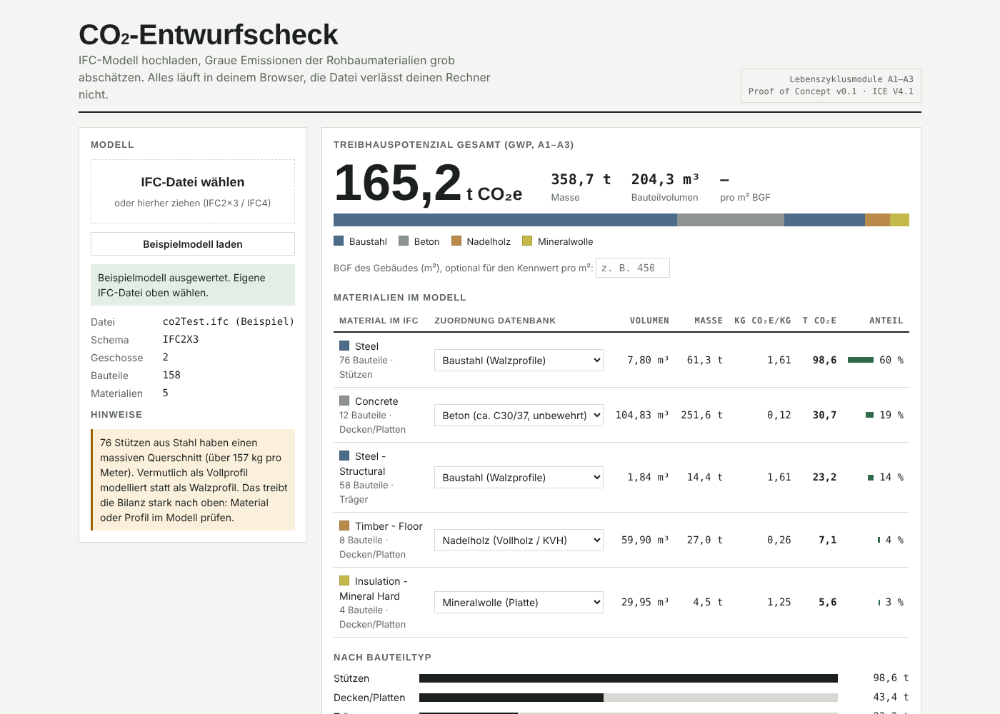

# CO₂-Entwurfscheck

> 🚧 **Früher Prototyp (v0.1)**: ein erster Proof of Concept, um zu testen, ob
> sich graue Emissionen direkt aus einem Entwurfsmodell sinnvoll abschätzen lassen.
> Die Ergebnisse sind Größenordnungen für den Variantenvergleich, keine Ökobilanz.

**▶ Live-Demo:** https://adriandfr.github.io/co2-entwurfscheck/

Kostenloses Open-Source-Tool, das aus einem IFC-Modell die grauen Emissionen
(GWP, Module A1–A3) der Rohbaumaterialien grob abschätzt. Gedacht für
Architekturstudierende und alle, die einen Entwurf schnell einordnen wollen.

Alles läuft im Browser. Das Modell verlässt den eigenen Rechner nicht.

## Warum

Im Entwurf fallen die Entscheidungen mit dem größten CO₂-Hebel (Tragwerk,
Material, Spannweiten), aber eine Ökobilanz gibt es meist erst viel später.
Der Entwurfscheck gibt schon während des Entwerfens eine Größenordnung:
Modell exportieren, reinziehen, Varianten vergleichen.

## Benutzen

Live-Demo öffnen oder `index.html` herunterladen und per Doppelklick im Browser
öffnen (Chrome, Edge oder Firefox). Dann die IFC-Datei hineinziehen. Ein Beispielmodell ist eingebaut.

Für den IFC-Export aus Archicad: Übersetzer „General Parametric Export“.

## Wie es rechnet

1. Die IFC-Datei wird mit [web-ifc](https://github.com/ThatOpen/engine_web-ifc) gelesen.
2. Das Volumen jedes Bauteils wird aus der 3D-Geometrie berechnet.
3. Materialien kommen aus dem IFC (`IfcRelAssociatesMaterial`). Schichtaufbauten
   werden anteilig nach Schichtdicke aufgeteilt.
4. Jedes Material wird per Stichwort einem Datenbankeintrag zugeordnet
   (in der Seite änderbar).
5. Masse = Volumen × Dichte, GWP = Masse × Emissionsfaktor.
6. Plausibilitätshinweise, z. B. wenn Stahlstützen als Vollprofil modelliert sind.

## Datengrundlage

Die Emissionsfaktoren (Module A1–A3, kg CO₂e/kg) stammen aus der
**Inventory of Carbon & Energy (ICE) Database V4.1**, Circular Ecology, Oktober 2025
([aktuelle Version und Download](https://circularecology.com/embodied-energy-and-carbon-footprint-database.html)).

| Baustoff im Tool | ICE-Datensatz | kg CO₂e/kg |
|---|---|---|
| Beton (ca. C30/37) | In-situ concrete, 28/35 MPa | 0,122 |
| Stahlbeton | Beton 28/35 + 120 kg/m³ Steel, Rebar (1,72) | 0,199 |
| Baustahl (Walzprofile) | Steel, Section (worldsteel 2023) | 1,61 |
| Brettsperrholz (BSP) | Timber, CLT | 0,25 |
| Brettschichtholz (BSH) | Timber, Glulam | 0,28 |
| Nadelholz (Vollholz/KVH) | Timber, Softwood | 0,263 |
| Holzfaserdämmung | Timber, Fibreboard (Näherung) | 0,715 |
| Mineralwolle | Insulation, Mineral Wool | 1,25 |
| Glaswolle | Insulation, Glass Wool | 1,533 |
| EPS / XPS | Insulation, Polystyrene | 3,69 |
| Ziegel | Bricks, General | 0,213 |
| Gipskarton | Plaster, Plasterboard | 0,238 |
| Flachglas | Glass, General | 1,437 |
| Kalksandstein | *nicht in ICE, Schätzwert* | 0,15 |

Holz ist ohne biogenen Kohlenstoffspeicher gerechnet. Die Rohdichten sind
typische Werte (eigene Annahmen). Alle Werte lassen sich in der Seite anpassen.

**Grenzen:** ICE liefert britische/europäische Durchschnittswerte, keine
Hersteller-EPDs. Nicht enthalten sind Verbindungsmittel, Ausbau, TGA, Transport
und Baustelle (A4–A5). Das Ergebnis ist eine Größenordnung für Variantenvergleiche,
keine Ökobilanz nach DIN EN 15978.

## Status & nächste Schritte

Proof of Concept, v0.1. Die Kernidee funktioniert: IFC rein, Mengen und
CO₂-Größenordnung raus. Für ein brauchbares Werkzeug ist geplant:

- Deutsche Datensätze aus der [ÖKOBAUDAT](https://www.oekobaudat.de) als Alternative zu ICE
- Grobe Kostenschätzung nach DIN 276 auf Basis derselben Mengen
- Direkte Anbindung an Archicad statt IFC-Export
- KI-Tab mit Verbesserungsvorschlägen zum Entwurf

## Weiterentwickeln

- Code bearbeiten: `src/template.html` (HTML, CSS und JavaScript in einer Datei)
- Neu bauen: `python build.py` → erzeugt `index.html`
- Emissionsfaktoren: Liste `LIB` oben im Skript in `src/template.html`

## Lizenz

Code: MIT, siehe `LICENSE`. Die ICE-Emissionsfaktoren unterliegen den
[Nutzungsbedingungen von Circular Ecology](https://circularecology.com/terms-of-use.html)
und sind nicht Teil der MIT-Lizenz.
